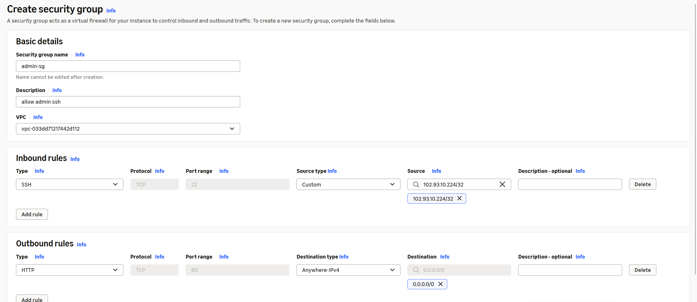
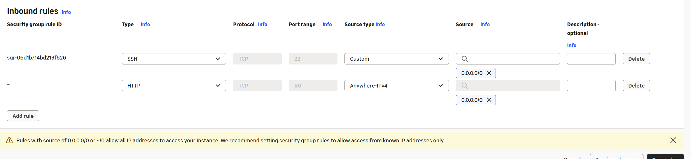
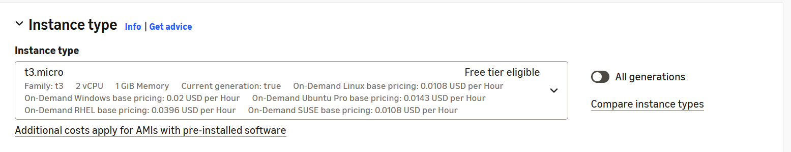
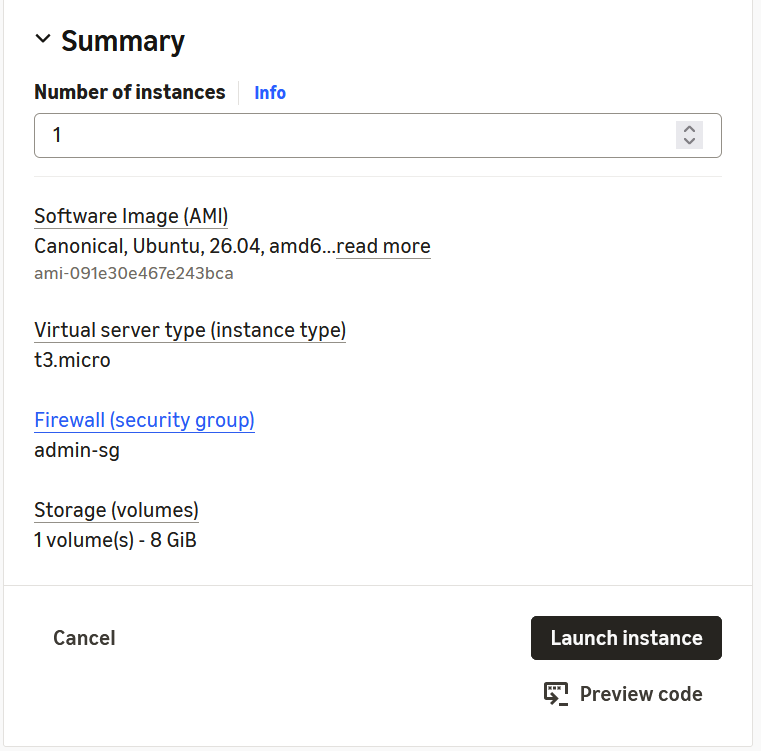
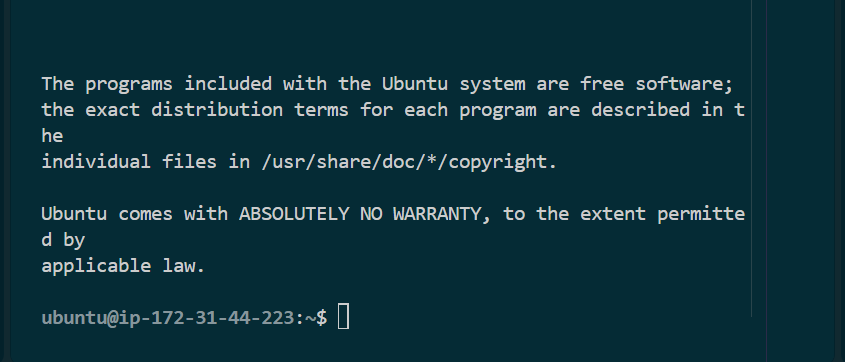
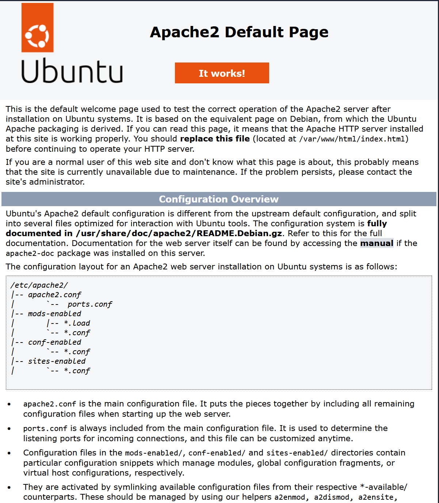

****SIMPLE WEBSITE WITH APACHE/NGINX ON EC2****

This repository shows a simple documentation on how to launch EC2 instances in the cloud and host simple web applications in them.


1. Set-Up Security Group

Type EC2 into your AWS search bar and click create security group.




Click add rule
set your **Inbound Rules**




click **create group/create rule**

****Launch Instance and install Apache****


Go **Instances** and select **Launch an Instance**

Instance Type



From Application And OS Image Choose **Ubuntu or Amazon** 

Choose ***Instance Type and create Key Pair**


Select ***Security Group***


**LAUNCH INSTANCES**



Connect to Your Instance



Open your terminal (or PowerShell/Command Prompt on Windows), navigate to the folder where you saved **KEY PAIR**

And run the following command 

```
chmod 400 "keypair.pem"

ssh -i "name of your key pair.pem" ubuntu@ec2-13-61-**-**.eu-north-1.compute.amazonaws.com
```
Install Your Web Server

Install Nginx

```
sudo apt update
sudo apt install nginx -y
sudo systemctl enable --now nginx
```
Install Apache

```
sudo apt update
sudo apt install apache2 -y
sudo systemctl enable --now apache2
```
to allow apache and nginx run concurrently without port conflicts, run this 

```
sudo sed -i 's/Listen 80/Listen 8080/g' /etc/apache2/ports.conf
sudo sed -i 's/:80/:8080/g' /etc/apache2/sites-available/000-default.conf
```
***SUCCESSFULY HOSTED***



***Replace with Your Own Website**

Upload Your Files from Your Local Computer
```
scp -i "admininsatancekp.pem" -r index.html style.css Images ubuntu@13.61.xxx.xxx:/tmp/
```
Connect to Your EC2 Server and Move the Files

```
ssh -i "admininsatancekp.pem" ubuntu@13.61.175.172
```

```
sudo mv /tmp/index.html /tmp/style.css /tmp/Images /var/www/html/
sudo chown -R www-data:www-data /var/www/html/
```

Refresh Your Browser


